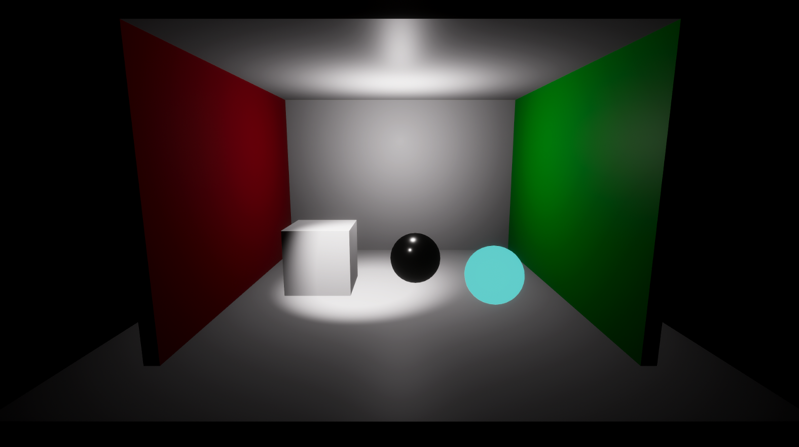
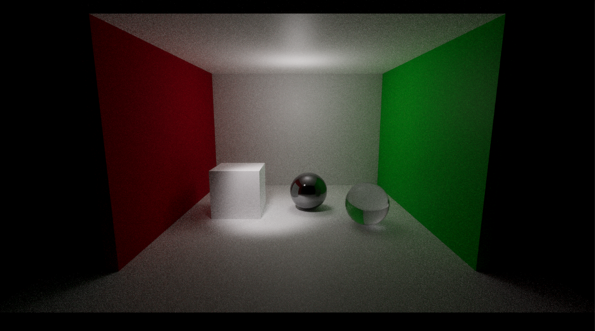

# Grau A — Técnicas Avançadas de Computação Gráfica

## Ray Tracing, Path Tracing e Iluminação Global na Unity HDRP

Projeto acadêmico desenvolvido na **Unity 6.6 (6000.6.5f1)** com **High Definition Render Pipeline (HDRP 17.6.0)** e **DirectX 12**, com o objetivo de comparar a renderização convencional em tempo real com Path Tracing na mesma cena.

## Objetivo

Demonstrar os fenômenos de **iluminação direta, sombras, reflexão especular, refração/transparência, iluminação indireta e color bleeding** e discutir as diferenças visuais e computacionais entre duas abordagens de renderização.

## Cena desenvolvida

A cena `Laboratorio_Iluminacao` é inspirada na **Cornell Box**, ambiente experimental utilizado em estudos de iluminação global. O cenário foi construído com objetos primitivos da Unity e inclui:

- Sala com parede esquerda vermelha, parede direita verde e demais superfícies claras.
- Cubo branco fosco, para observar a iluminação difusa e as sombras.
- Esfera metálica, para analisar a reflexão especular.
- Esfera transparente, para analisar transmissão e refração.
- Duas fontes de luz em tempo real: **MainLight (Point Light)** e **AccentLight (Spot Light)**; a luz direcional Sun foi desativada na composição final.

Os materiais foram criados no projeto com o shader `HDRP/Lit`: `MAT_White`, `MAT_Red`, `MAT_Green`, `MAT_Metal` e `MAT_Glass`.

## Ferramentas e metodologia

| Item | Configuração |
| --- | --- |
| Engine | Unity 6000.6.5f1 |
| Pipeline | HDRP 17.6.0 |
| API gráfica | DirectX 12 (DX12) |
| Técnica 1 | Renderização em tempo real, sem o override Path Tracing |
| Técnica 2 | Path Tracing ativado em um Global Volume |
| Path Tracing — Maximum Samples | 512 |
| Path Tracing — Minimum Depth | 1 |
| Path Tracing — Maximum Depth | 6 |
| Redução de ruído | Intel Open Image Denoise, configurado no projeto |

As duas imagens foram produzidas mantendo a geometria, a câmera, os materiais e as fontes de luz, alternando o estado do **Path Tracing** no Volume. A renderização Path Tracing acumula amostras progressivamente; por isso, seu resultado e nível de ruído dependem do tempo de convergência e do denoising.

## Resultados visuais

| Tempo real | Path Tracing |
| --- | --- |
|  |  |

**Principais observações nas capturas:**

- **Reflexão:** em tempo real, a esfera central aparece predominantemente preta, com destaques pontuais. Com Path Tracing, ela apresenta reflexos reconhecíveis do ambiente vermelho e verde.
- **Refração/transparência:** a esfera à direita parece azul-esverdeada e opaca na captura em tempo real. Com Path Tracing, torna-se parcialmente transparente, revelando e distorcendo o ambiente por trás dela.
- **Sombras:** ambos os modos geram sombras, mas a distribuição e as transições de iluminação são diferentes.
- **Iluminação indireta / color bleeding:** na captura Path Tracing, percebe-se uma contribuição verde sutil no chão próximo à parede direita, compatível com luz refletida pela superfície colorida. O efeito depende das condições de iluminação e pode ser produzido também por técnicas de iluminação global em tempo real quando habilitadas.
- **Ruído:** o Path Tracing apresenta ruído visível por utilizar amostragem estocástica. Aumentar o número de amostras e aplicar denoising ajuda a reduzi-lo.

> **Observação técnica:** este experimento compara as **configurações específicas** escolhidas para o HDRP. Não significa que todo renderizador em tempo real seja incapaz de calcular iluminação indireta, color bleeding ou reflexos ray traced.

## Como abrir o projeto

1. Instale a versão **Unity 6000.6.5f1** no Unity Hub.
2. Baixe ou clone este repositório completo.
3. No Unity Hub, escolha **Add project from disk** e selecione a pasta do repositório (onde estão `Assets`, `Packages` e `ProjectSettings`).
4. Aguarde a importação e compilação dos shaders HDRP.
5. Abra a cena `Assets/Scenes/Laboratorio_Iluminacao.unity`.
6. Para reproduzir o Path Tracing, utilize Windows, DirectX 12 e GPU compatível com DXR. Se necessário, confirme que Ray Tracing está ativo no HDRP Asset e na Main Camera.
7. No Game View, selecione `PathTracing_Volume` e alterne `Path Tracing > State` entre `Disabled` e `Enabled`.

**Observação:** pastas temporárias como `Library` e `Temp` não são incluídas no Git; a Unity as reconstrói automaticamente ao abrir o projeto.

## Assets utilizados

Não foram utilizados modelos 3D, texturas ou cenários de terceiros. Os recursos visuais foram criados diretamente no Unity:

- Objetos primitivos nativos: Cube, Sphere e Plane.
- Materiais criados com `HDRP/Lit`.
- Luzes e câmera nativas do Unity HDRP.
- Volumes e overrides do HDRP.

Pacotes que fazem parte da configuração do projeto são registrados em `Packages/manifest.json` e `Packages/packages-lock.json`.

## Referências

1. **Cornell University.** *The Cornell Box*. https://bowers.cornell.edu/cornell-box
2. **Goral, C. M.; Torrance, K. E.; Greenberg, D. P.; Battaile, B.** (1984). *Modeling the Interaction of Light Between Diffuse Surfaces*. Computer Graphics, 18(3), 213–222. https://doi.org/10.1145/964965.808601
3. **Kajiya, J. T.** (1986). *The Rendering Equation*. Computer Graphics, 20(4), 143–150. https://doi.org/10.1145/15886.15902
4. **Pharr, M.; Jakob, W.; Humphreys, G.** (2023). *Physically Based Rendering: From Theory to Implementation*, 4ª edição. https://pbr-book.org/4ed/
5. **Unity Technologies.** *Understand path tracing* (HDRP 17.x). https://docs.unity.cn/Packages/com.unity.render-pipelines.high-definition@17.0/manual/path-tracing-understand.html
6. **Unity Technologies.** *Path tracing reference* (documentação do HDRP). https://github.com/Unity-Technologies/Graphics/blob/master/Packages/com.unity.render-pipelines.high-definition/Documentation~/reference-path-tracing.md

## Entrega

Trabalho prático de Grau A — Técnicas Avançadas de Computação Gráfica. O repositório reúne os arquivos da cena Unity, as imagens de comparação e as referências utilizadas.
